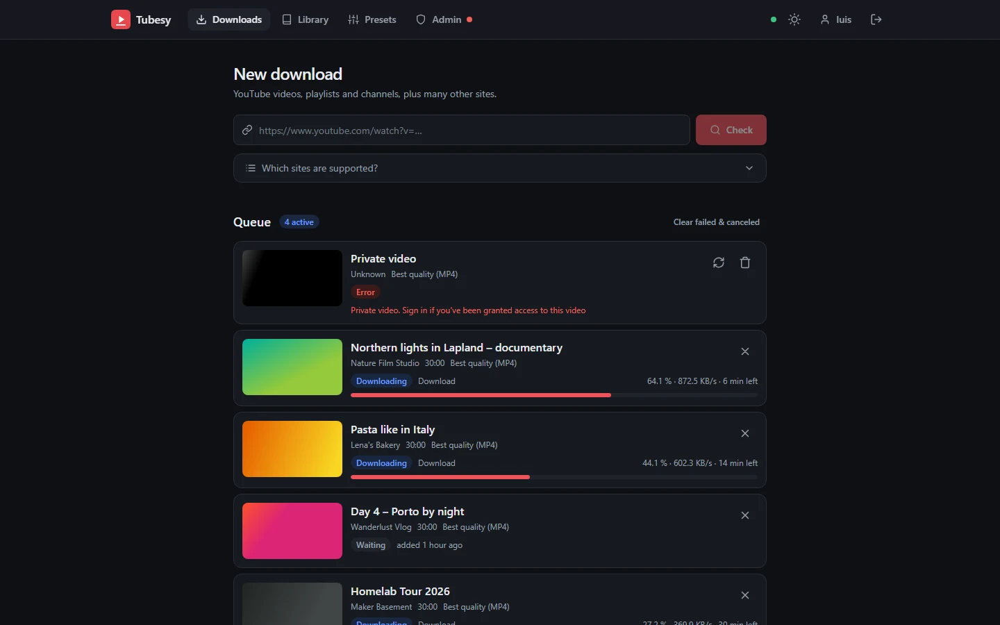
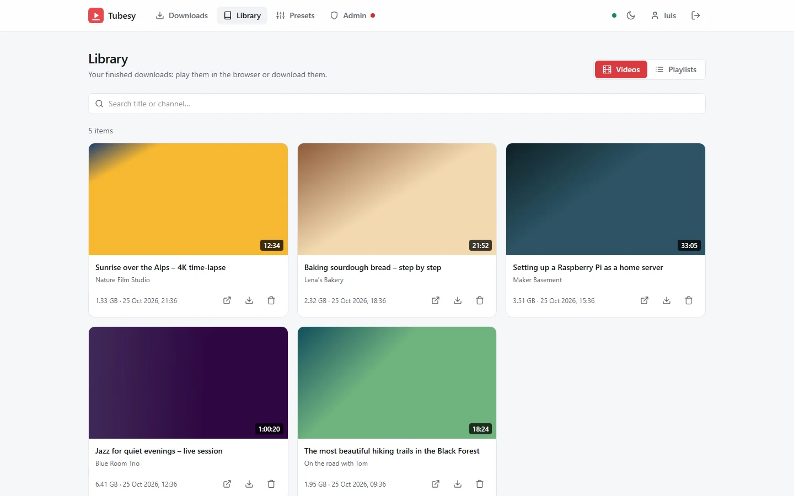
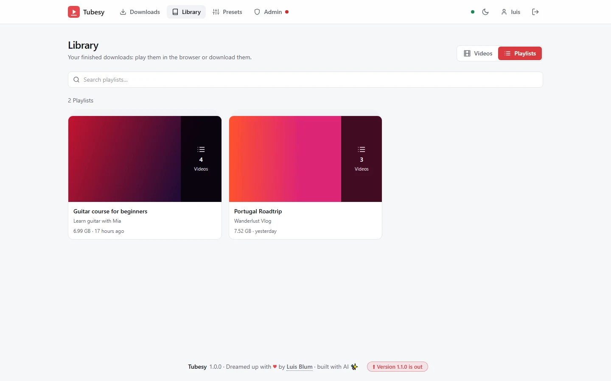
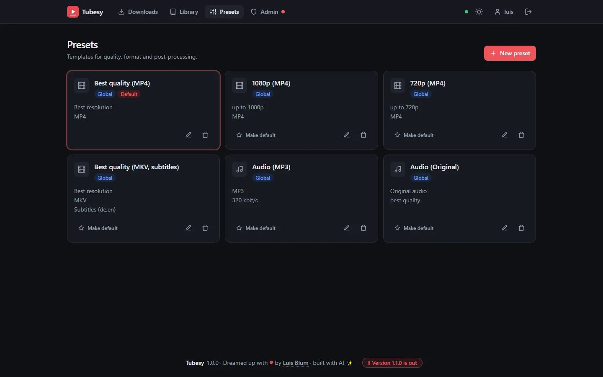
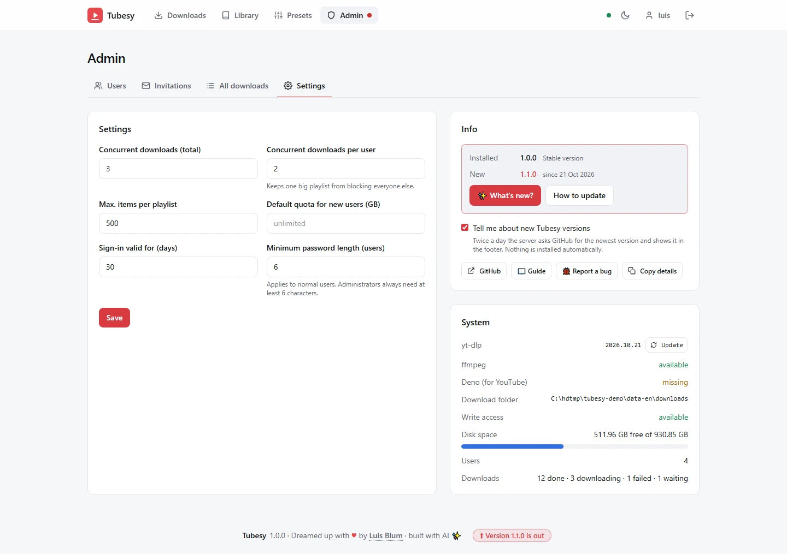
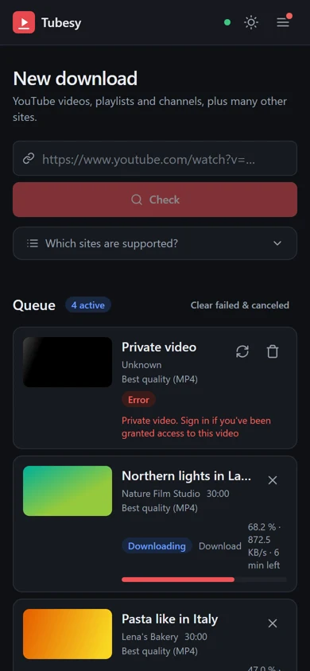

<p align="center">
  
</p>

<h1 align="center">Tubesy</h1>

<p align="center">
  A self-hosted video downloader for your home server – with a clean web interface, user accounts and permissions.<br>
  YouTube videos, playlists and channels, and more than 1000 other sites, powered by <a href="https://github.com/yt-dlp/yt-dlp">yt-dlp</a>.
</p>

<p align="center">
  <b>English</b> · <a href="README.de.md">Deutsch</a>
</p>


<p align="center"><sub>Screenshots with demo data</sub></p>

## Highlights

- **Paste, check, download** – preview title and length first, then pick a preset. Live progress with speed and remaining time, cancel and retry.
- **Playlists and channels** – choose single videos or all of them; each playlist gets its own numbered folder and can be downloaded as a ZIP later.
- **Presets** – resolution, MP4/MKV/WebM, audio only (MP3, M4A, Opus, FLAC, WAV), subtitles, thumbnail, metadata, chapters, SponsorBlock and file name templates. Global presets plus your own.
- **Library** – search, play in the browser, download to your device.
- **For the whole household** – accounts with roles, invitation links, a folder per user, storage quotas and fair queueing, so one big playlist doesn't block everyone else.
- **Safe to put online** – Argon2 passwords, HttpOnly session cookies, CSRF protection, sign-in rate limits, a session list per account and strict security headers.
- **Always working** – yt-dlp updates itself on every start; Tubesy tells you when a new version of itself is out.
- **English and German**, dark and light mode, works on the phone and installs as an app – on Android with *Share → Tubesy*.
- **API** for dashboards like [Heimdeck](https://github.com/MrLuigi938/heimdeck) and for automations.

| | |
|---|---|
|  |  |
|  |  |

<p align="center"></p>

## Quick start (Docker Compose)

```yaml
services:
  tubesy:
    image: ghcr.io/mrluigi938/tubesy:latest
    container_name: tubesy
    restart: unless-stopped
    ports:
      - "8080:8080"
    environment:
      TZ: Etc/UTC          # your time zone, e.g. Europe/London
      PUID: 1000           # owner of the download folder (`id <user>`)
      PGID: 1000
    volumes:
      - ./config:/config
      - ./downloads:/downloads
```

```sh
docker compose up -d
```

Open `http://<your-server>:8080`, choose your language and create the administrator account. Invite more people under **Admin → Invitations**.

## Installation

| | |
|---|---|
| 🐳 [Docker Compose](docs/en/docker-compose.md) | recommended for most home servers |
| 🐳 [Docker](docs/en/docker.md) | `docker run`, Podman |
| 🗄️ [NAS and container managers](docs/en/nas.md) | Synology, QNAP, Unraid, TrueNAS SCALE, Portainer |
| 🖥️ [Proxmox VE](docs/en/proxmox.md) | its own LXC container with one script |
| 🐧 [Debian / Ubuntu / Raspberry Pi OS](docs/en/debian.md) | without Docker, as a systemd service |

Runs on amd64 and arm64 (e.g. Raspberry Pi 4/5).

## Documentation

- [Installation overview](docs/en/installation.md)
- [Configuration](docs/en/configuration.md)
- [Reverse proxy and HTTPS](docs/en/reverse-proxy.md) – SWAG, Nginx Proxy Manager, Caddy, Traefik
- [Updating](docs/en/updating.md)
- [Usage](docs/en/usage.md)
- [API](docs/en/api.md)
- [Troubleshooting](docs/en/troubleshooting.md)
- [Development](docs/en/development.md)

## Please download responsibly

Tubesy is a tool for saving videos you are allowed to keep – your own uploads, Creative Commons content, or what the law of your country permits for private use. Respect copyright and the terms of the sites you use.

## License

[GNU Affero General Public License v3.0](LICENSE)

---

<p align="center">
  Dreamed up with <span title="love">♥</span> by <a href="https://github.com/MrLuigi938">Luis Blum</a> · built with AI ✨
</p>
